<a href="https://st9wd.com">
  <picture>
    <source media="(prefers-color-scheme: dark)" srcset="assets/dark/hero.svg">
    
  </picture>
</a>

  <a href="https://st9wd.com"><picture><source media="(prefers-color-scheme: dark)" srcset="assets/dark/btn-0.svg"></picture></a>
  <a href="https://linkedin.com/in/useit015"><picture><source media="(prefers-color-scheme: dark)" srcset="assets/dark/btn-1.svg"></picture></a>
  <a href="mailto:useit015@gmail.com"><picture><source media="(prefers-color-scheme: dark)" srcset="assets/dark/btn-2.svg"></picture></a>
  <a href="https://github.com/useit015/useit015/issues/new?title=sign&body=Press%20%22Create%22%20and%20the%20notebook%20writes%20your%20GitHub%20handle%20into%20the%20margin%20of%20this%20profile.%20This%20issue%20closes%20itself%20a%20minute%20later.%0A%0AOnly%20your%20handle%20is%20used.%20Anything%20you%20write%20here%20stays%20in%20this%20issue."><picture><source media="(prefers-color-scheme: dark)" srcset="assets/dark/btn-3.svg"></picture></a>

<a href="https://ballpoint.st9wd.com"><picture><source media="(prefers-color-scheme: dark)" srcset="assets/dark/card-ballpoint.svg"></picture></a>

  <a href="https://meowtal.st9wd.com"><picture><source media="(prefers-color-scheme: dark)" srcset="assets/dark/card-meowtal.svg"></picture></a>
  <a href="https://github.com/useit015/whichmodel"><picture><source media="(prefers-color-scheme: dark)" srcset="assets/dark/card-whichmodel.svg"></picture></a>
  <a href="https://github.com/useit015/whoisonline"><picture><source media="(prefers-color-scheme: dark)" srcset="assets/dark/card-whoisonline.svg"></picture></a>
  <a href="https://github.com/useit015/aart"><picture><source media="(prefers-color-scheme: dark)" srcset="assets/dark/card-glyph-studio.svg"></picture></a>

<picture>
  <source media="(prefers-color-scheme: dark)" srcset="assets/dark/ink.svg">
  
</picture>

<a href="https://github.com/useit015/useit015/issues/new?title=sign&body=Press%20%22Create%22%20and%20the%20notebook%20writes%20your%20GitHub%20handle%20into%20the%20margin%20of%20this%20profile.%20This%20issue%20closes%20itself%20a%20minute%20later.%0A%0AOnly%20your%20handle%20is%20used.%20Anything%20you%20write%20here%20stays%20in%20this%20issue.">
  <picture>
    <source media="(prefers-color-scheme: dark)" srcset="assets/dark/guestbook.svg">
    
  </picture>
</a>

<b>More pages from the notebook</b>

 

- [LHAJ](https://smkr.vercel.app): a third-person 3D character controller and small game engine in Three.js. [Play it](https://smkr.vercel.app), or read the [repo](https://github.com/useit015/smkr).
- [invoicer](https://github.com/useit015/invoicer): invoice CLI with a JSON contract, validation, themes and HTML/PDF rendering. Built for terminal and agent use.
- [lengthfmt](https://github.com/useit015/lengthfmt): sorts imports, object properties and React dependencies by line length.
- [Little Company](https://github.com/useit015/faces): eighteen procedurally drawn animal friends in one Canvas 2D file. No assets.
- [Souk Fighter](https://github.com/useit015/souk-fighter): web fighting game with a character customizer and asset bundles. React 19 and Pixi.js 8.
- [arena-forge](https://github.com/useit015/arena-forge): browser level editor for arena maps, exported as JSON. Three.js.
- [red_tetris](https://github.com/useit015/red_tetris): real-time two-player Tetris, from 42.

Earlier 42 / 1337 coursework is archived on this profile.

<b>How this page is drawn</b>

 

Every line here is a seeded pen stroke from [Ballpoint](https://github.com/useit015/ballpoint)'s stroke engine, and every letter is a Gaegu outline written in one at a time. [`scripts/build.ts`](scripts/build.ts) draws each sheet twice, for light and dark, as plain SVG with CSS animation. No JavaScript, no external services.

A GitHub Action redraws the ink calendar every night from the GraphQL API. Opening an issue titled `sign` runs [another one](.github/workflows/guestbook.yml) that adds your handle to [`data/guestbook.json`](data/guestbook.json) and writes it into the margin.

